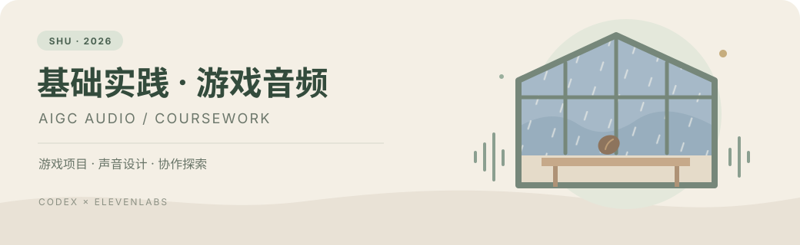
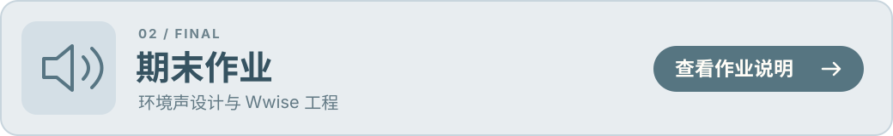

<p align="center">
  
</p>

# SHU 2026 基础实践：游戏音频

本仓库用于提交基础实践课程的平时作业（Task）与期末作业（Final）。

平时报告以正在制作的聚光灯 GameJam 项目为基础：由我把控项目方向与决策，Codex 作为项目中枢梳理游戏资料和资产、提出音频风格建议，再结合 ElevenLabs 开展生成与后续适配探索。报告依据本窗口交互和实际成果整理，并披露协作分工。

## 作业入口

[](task/research.md)

[](final/README.md)

**在线报告与试听：** [打开播放器，试听已选用的雨声与桌面敲击](https://Nnnnobel.github.io/shu261-audio-practice-2026/)

**快速访问：** [平时调研报告](task/research.md) · [实验计划](task/experiment-plan.md) · [实验记录](task/experiment-records.md) · [提示词中英文对照](task/generation-log-20261015.md) · [期末作业说明](final/README.md)

### 内容与进度

| 作业 | 内容 | 入口 | 当前状态 |
| --- | --- | --- | --- |
| 平时作业 Task | 基于真实游戏项目的 AI 音频设计协作探索 | [调研文档](task/research.md) · [实验计划](task/experiment-plan.md) | 雨声第二轮 #1、桌面人工调响最终版已选用并归档；种子暂不采用 |
| 期末作业 Final | 环境声设计与 Wwise 工程 | [期末作业说明](final/README.md) | 待开始 |

---

## 目录

```text
task/
  research.md       调研题目、大纲与后续正文
  experiment-plan.md 实验步骤、提示词草案与评价方法
  experiment-records.md 实验记录表（未开展项留空）
  assets/           调研配图、音频或视频等辅助材料
final/
  README.md         期末作业要求摘要，后续补充实际成果入口
docs/readme-assets/  README 页头与作业入口图形
docs/audio/          选用音频、来源与文件校验信息
docs/index.html      带音频播放器的报告网页
```

## 平时作业要求

- 以“当下 AIGC 在游戏音频设计中的应用”为主题开展调研。
- 可选择 Voice、Music、SFX，或 Text-to-Audio、Text-to-Video 等生成模式，也可选择其他感兴趣的切入点。
- 文字使用 Markdown（`.md`），可附图片、视频等辅助材料。
- 仓库保持公开，完成后通过邮件提交仓库链接。
- 邮件标题：`SHU261基础实践_Task_[学号]_[姓名]`。

以上为课程附件要求摘要。当前已完成[首轮生成](task/generation-log-20261015.md)、[第二轮调整](task/iteration-02-20261015.md)、[第三轮种子与桌子调整](task/iteration-03-20261015.md)、[第四轮桌面声微调](task/iteration-04-20261015.md)及[第五轮零秒起音与混响调整](task/iteration-05-20261015.md)，均保留中英文提示词。首轮之后先在网页查看；已选用第二轮雨声 #1 与桌面声人工调整最终版，音频已归档；种子三轮后仍未找到合适声音，暂不采用。阶段结果已写入报告，游戏验证、音乐实验和邮件提交待完成。

## 更新仓库

在本仓库目录中执行：

```bash
git status
git add README.md task final .gitignore
git commit -m "Update coursework"
git push
```

上传辅助材料时，在调研文档中注明来源、用途及必要的授权信息；仅上传适合公开的内容。
