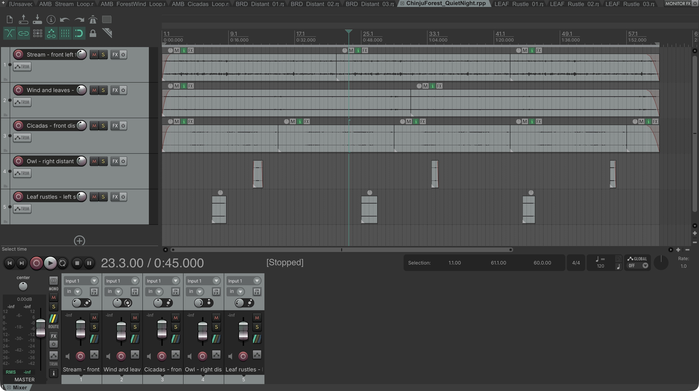

# 镇守之森溪畔

上海大学《基础实践》期末作业 · 郑皓文 · 24122339

[完整 Word 报告](报告/24122339_郑皓文_基础实践期末报告.docx) · [两分钟混音试听](Reaper_Night/Exports/ChinjuForest_Final_120s.wav) · [工程下载与打开方法](#工程下载与打开方法)

## 选题

首先，我分析了老师的要求：准备持续的环境底声和至少三条间断随机声，在 Wwise 中完成循环、随机触发、距离变化和试听。我觉得这门课不需要一开始就做很复杂的场景，于是想复刻一个游戏里比较简单的场景。

最近我重新看了《星际穿越》，对里面声音使用的「克制感」有一些想法；同时，我也在复刻《原神》的渲染，因此选择了《原神》稻妻的「镇守之森」。我想表现的是村落边界一片夜晚森林的静谧感。

参考画面与 Word 报告一致，游戏为《原神》。

## 场景分析与素材寻找

画面左侧可以明显看到溪流，周围有草丛和树木。在游戏里，还能听到时不时出现的蝉鸣与淡淡的鸟叫声。我决定以溪流为主，风声和细微虫鸣铺在周围，再加入远处猫头鹰的间断叫声。

上次平时作业中，AI 生成音频的结果并不都让我满意，尤其是种子发芽声，多次尝试后仍未采用。因此，这次我选择寻找真实音效。做作业的这几天上海一直在下雨，外录也不太方便，我便转向素材库，经过比对后决定先在 Freesound 中寻找免费资源。

最终选用了 Gentle Stream、Wind(leaves).WAV、cicadas (Palawan, Philippines).wav 和 owl.wav 四份录音，具体来源见[素材署名](CREDITS.md)。

## 剪辑与导出

选好素材后，我使用 REAPER 剪辑。试听时发现，溪流原素材从 46 秒以后质量明显下降，于是剪掉了这一部分。我保留 2—44 秒作为主体，用 44—46 秒与开头做两秒交叉淡化，得到 42 秒的循环素材。风声和蝉鸣也在循环接缝处做了交叉淡化。

猫头鹰从同一录音中截取三段不同叫声，分别降低约 25、19 和 22 dB。树叶声也选取三个不同片段，每条加入 0.4 秒淡入、0.8 秒淡出，让细节声进入时更柔和。

我在五轨 REAPER 工程中预览整体混音，把猫头鹰和树叶片段分散放在时间线上，先听各层声音叠加后的效果。随后按作业要求导出素材，再导入 Wwise 设置播放方式。

九个资产统一导出为 48000 Hz、24 bit、立体声 WAV。溪流长 42 秒，风声长 60 秒，均满足持续底声大于 30 秒的要求；六条短素材用于间断随机播放。

## 在 Wwise 中调整声音

我使用课程指定的 Wwise 2025.1.11.9262，建立 ChinjuForest 工程。基底环境声是小溪流淌的声音，导入后启用 Loop 和 Infinite，让它持续循环播放。

一开始，溪流有一种很贴近耳朵、像在倒水的听感，与画面里有一定距离的溪流不太相符。于是，我设置 Positioning，把它放在前方稍偏左的位置，再向远处和下方调整。现在溪流距离听者约 23 米，听起来有了更明确的方位和距离。

只有溪流时，环境仍显得有些空，听感也比较假。因此，我加入较轻的风声和细微蝉鸣作为环境底层，让它们同样循环播放。风声铺在周围，蝉鸣放在前方远处，音量保持较低，让溪流仍然是主要声音。

## 随机声的安排

接下来是间断出现的随机声。连续的溪流和风声已经建立了环境，我希望偶尔有一些声音提醒人注意到树林里的动静。结合至少三条随机声音的要求，我将猫头鹰叫声剪成三段，又补充三条短树叶声，一共六条，分成两个 Random Container。

猫头鹰放在右前方远处。我希望它听起来只是远处偶尔传来的叫声，所以先降低素材响度，再通过距离衰减把它放到背景中。容器使用 Shuffle，并避免紧接着重复同一段叫声；第一次延迟 22 秒，之后每次间隔 40—65 秒，让环境中保留足够的安静时间。

树叶声用来补充草丛和树木的细节。我从风叶录音中另选三个短片段，放进独立的 Random Container。第一次延迟 12 秒，之后间隔 24—40 秒；容器音量为 −14 dB，并设置 ±1 dB 的小幅变化。这样，它会与远处猫头鹰交错出现。

我为两组随机声设置了 3D Position 和 Attenuation：猫头鹰在右方远处，树叶在左前方，约为左侧 8 米、前方 2 米。不同方位的细节让场景更有空间分布感，距离增加时声音也会减弱。

## Soundcaster 试听

最后，我在 Soundcaster Session 中试听完整场景。ChinjuForest_Demo 可以播放、停止整场声音，也能单独试听猫头鹰、蝉鸣和树叶。五个 Level 参数保留了各层音量的调整入口，便于后续替换素材或继续修改混音。

## 自我评价

做完之后，我觉得最明显的变化来自声音之间的关系。溪流保持连续，风声和细微蝉鸣补足环境，猫头鹰和树叶隔一段时间才出现。把溪流从耳边推到画面中的位置、把猫头鹰压到远处之后，整个场景才逐渐有了我想要的静谧感。

这次作业也让我进一步理解了自己想尝试的「克制感」：每一层声音都有明确的作用，细节之间留出间隔，听者才有空间感受这个环境。后续我想继续比较不同耳机下的方位感，并寻找音质更好的原始素材，尤其是远处猫头鹰的录音。

## 工程下载与打开方法

下载仓库的 ZIP 并解压，保留 `final` 文件夹的完整目录。

1. 用 Wwise **2025.1.11.9262** 打开 [ChinjuForest.wproj](Wwise/ChinjuForest_QuietNight/ChinjuForest.wproj)。
2. 在 **Sessions → Soundcaster Sessions → ChinjuForest** 中打开 **ChinjuForest_Demo**，点击 **Play_ChinjuForest** 的 ▶ 开始试听，点击 **Stop_ChinjuForest** 的 ▶ 停止。
3. 五个 `*_Level` 参数可以调整各层音量；`Play_Birds_Only`、`Play_Cicadas_Only`、`Play_Leaves_Only` 用于单独试听。

[REAPER 五轨工程](Reaper_Night/ChinjuForest_QuietNight.rpp)与[九个素材剪辑工程](Reaper_Night/AssetProjects)也保留在仓库中，修改方法见 [REAPER 说明](Reaper_Night/README.md)。两分钟 WAV 是 REAPER 中的固定编排，随机播放效果在 Wwise 工程中试听。

完整制作过程、平时作业和 AI 创作披露保留在 [Word 报告](报告/24122339_郑皓文_基础实践期末报告.docx)中。声音素材来源与许可见 [CREDITS.md](CREDITS.md)。
