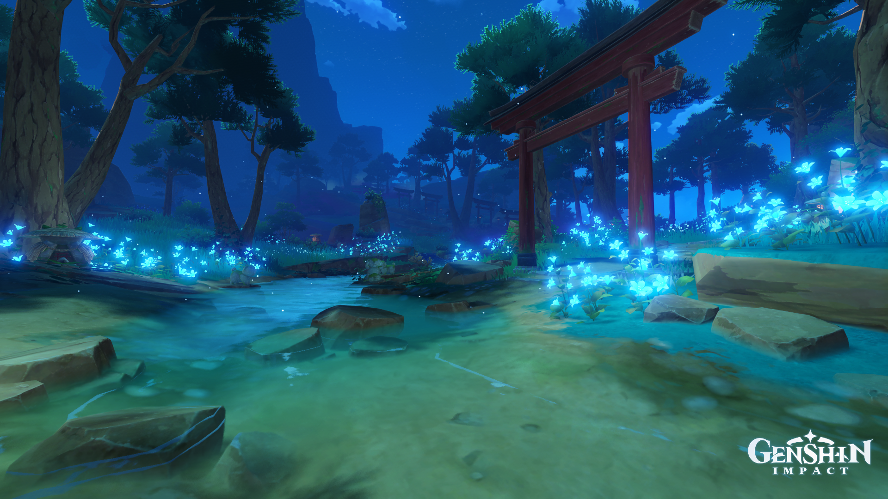
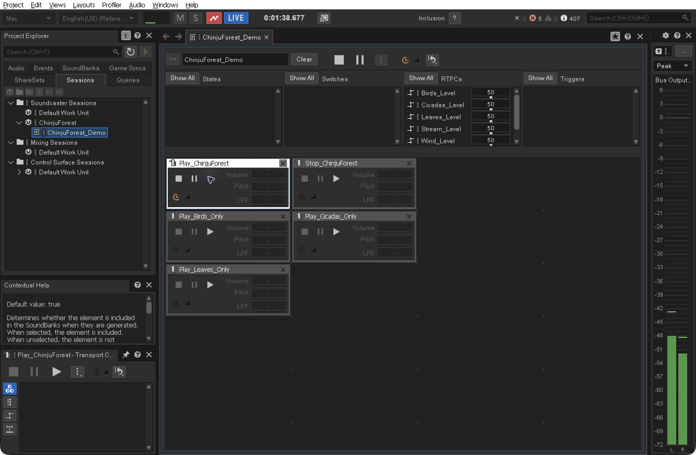

# 镇守之森溪畔

上海大学《基础实践》期末作品 · 郑皓文 · 24122339

以《原神》稻妻「镇守之森」的夜间溪畔为参考，在 Wwise 中制作一个以流水为主、风声与细微蝉鸣铺底、猫头鹰和树叶声间断出现的宁静森林环境。



图源：HoYoLAB 的 Jinxed Encounter，[Chinju Forest - Viewpoint](https://www.hoyolab.com/article/15209680)。游戏画面相关权利归原权利方，作为课程场景参考。

## 查看与下载

- [完整 Word 报告](报告/24122339_郑皓文_基础实践期末报告.docx)：包含实践总结、完整平时作业、期末制作过程、截图与 AI 创作披露。
- [Wwise 工程](Wwise/ChinjuForest_QuietNight/ChinjuForest.wproj)：使用 **Wwise 2025.1.11.9262**。
- [REAPER 五轨混音工程](Reaper_Night/ChinjuForest_QuietNight.rpp)与[九个素材剪辑工程](Reaper_Night/AssetProjects)。
- [两分钟 REAPER 混音预览 WAV](Reaper_Night/Exports/ChinjuForest_Final_120s.wav)：固定编排预览；随机播放请在 Wwise 中试听。
- [制作截图](报告/制作过程截图)、[素材来源与署名](CREDITS.md)。

请使用仓库右上角 **Code → Download ZIP** 下载整个仓库并解压，或执行：

```bash
git clone https://github.com/Nnnnobel/shu261-audio-practice-2026.git
```

工程与媒体使用相对路径。保留 `final` 的完整目录，打开其中的 `.wproj` 或 `.rpp` 文件。

## 在 Wwise 中试听

1. 使用 Wwise **2025.1.11.9262** 打开 `Wwise/ChinjuForest_QuietNight/ChinjuForest.wproj`。
2. 在 Project Explorer 的 **Sessions → Soundcaster Sessions → ChinjuForest** 中打开 **ChinjuForest_Demo**。
3. 点击 **Play_ChinjuForest** 模块内的 ▶，三条底声开始循环播放。树叶首次约在 12 秒后出现，猫头鹰首次约在 22 秒后出现。
4. **Play_Birds_Only / Play_Cicadas_Only / Play_Leaves_Only** 可单独试听；点击 **Stop_ChinjuForest** 模块内的 ▶ 停止整场。
5. `Stream_Level`、`Wind_Level`、`Cicadas_Level`、`Birds_Level`、`Leaves_Level` 五个参数控制各层响度，范围 0–100，50 是基准。

整体声音保持较轻。播放时可查看 Soundcaster 输出电平，并确认系统输出设备；如果切换耳机后无声，停止播放并重启 Wwise 再试听。



## 选题与声音分析

我先分析了老师的要求：准备持续的环境底声和至少三条间断随机声，在 Wwise 中完成循环、随机触发、距离变化和试听。我觉得这门课不需要一开始就做很复杂的场景，于是想复刻一个游戏里比较简单的场景。

最近我重新看了《星际穿越》，对里面声音使用的「克制感」有一些想法；同时，我也在复刻《原神》的渲染，因此选择了稻妻的「镇守之森」。我想表现的是村落边界一片夜晚森林的静谧感。

画面左侧有溪流，周围有草丛和树木。在游戏里还能听到时不时出现的蝉鸣与淡淡的鸟叫声。我决定以溪流为主，风声和细微虫鸣铺在周围，再加入远处猫头鹰的间断叫声。

上次平时作业中的 AI 音频生成结果并不都让我满意，尤其是种子发芽声，多次尝试后仍未采用。这次选择寻找真实音效。做作业的这几天上海一直在下雨，外录也不太方便，于是转向素材库，经过比较后从 Freesound 寻找免费资源。使用关键词检索候选后，我再试听和筛选，最终选用溪流、风叶、蝉鸣和猫头鹰四份录音。

## REAPER 剪辑与导出

溪流原素材从 46 秒以后质量明显下降，因此排除了这一部分。我保留 2–44 秒作为主体，用 44–46 秒与开头做两秒交叉淡化，得到 42 秒的循环素材。风声与蝉鸣也在循环接缝处做了交叉淡化。

猫头鹰从同一录音中截取三段不同叫声，降低响度并添加淡入淡出；风叶录音另选三个短片段，每条加入 0.4 秒淡入、0.8 秒淡出。九个资产全部导出为 **48 kHz / 24 bit / stereo PCM WAV**。

| Wwise 资产 | 长度 | 用途 |
| --- | ---: | --- |
| AMB_Stream_Loop.wav | 42 秒 | 溪流持续底声 |
| AMB_ForestWind_Loop.wav | 60 秒 | 风叶持续底声 |
| AMB_Cicadas_Loop.wav | 28 秒 | 细微蝉鸣补充底层 |
| BRD_Distant_01 / 02 / 03.wav | 2.3 / 1.7 / 1.5 秒 | 猫头鹰随机短声 |
| LEAF_Rustle_01 / 02 / 03.wav | 3.5 / 4 / 3 秒 | 树叶随机短声 |

溪流和风叶均超过 30 秒，六条短素材用于间断随机播放。素材的选段和编辑入口见 [REAPER 说明](Reaper_Night/README.md)。


## Wwise 循环 随机与空间设置

三条基底声均开启 Loop 和 Infinite。一开始溪流有一种很贴近耳朵、像在倒水的听感，所以我设置 Positioning，把它放到前方稍偏左的位置，再向远处和下方调整。风声铺在周围，细微蝉鸣放在前方远处，让溪流仍然是主要声音。

连续底声建立环境之后，我希望偶尔有声音提醒人注意到树林里的动静。猫头鹰与树叶分别放进两个 Random Container，使用 Random / Shuffle、Continuous、无限循环、Delay，以及避免紧接着重复同一条的设置。

- **猫头鹰**：三段叫声放在右前方远处。首次延迟 22 秒，此后每段结束后随机等待 40–65 秒；较低的音量和距离衰减让叫声留在背景。
- **树叶**：三个片段放在左前方，首次延迟 12 秒，此后随机等待 24–40 秒；基础音量 −14 dB，随机变化 ±1 dB。

两组随机声均使用 3D Position 和 Attenuation，随距离增加而减弱。

| 声音层 | 基础音量 | 位置与实际预览距离 |
| --- | ---: | --- |
| 溪流 | −7 dB | 左前下方，约 23.09 米 |
| 风叶底声 | −27 dB | 宽立体声环境层 |
| 蝉鸣 | −11 dB | 正前方，约 22.75 米 |
| 猫头鹰 | −9 dB，随机 ±1 dB | 右前方，约 21.51 米 |
| 短树叶声 | −14 dB，随机 ±1 dB | 左前方，约 8.25 米 |

以上是容器基础音量，播放时叠加 RTPC 与距离衰减；溪流 Distance Scaling 为 95%。[保存的参数记录](Reaper_Night/Evidence/final_project_settings.json)提供具体坐标。

## 检查结果与作业要求

| 作业要求 | 本项目 |
| --- | --- |
| 场景图片与文字分析 | 镇守之森参考图与上述设计说明 |
| 大于 30 秒的持续声音 | 溪流 42 秒、风叶 60 秒 |
| 至少 3 条以上间断随机声 | 猫头鹰 3 条、树叶 3 条，共 6 条 |
| 48 kHz / 24 bit / stereo WAV | 9 条资产均符合，见[格式检查](Reaper_Night/Evidence/final_asset_formats.json) |
| 英文 Wwise 工程名及指定版本 | ChinjuForest；2025.1.11.9262 |
| 环境声持续循环 | 3 条底声均启用无限循环 |
| Random Container 随机播放 | 两个容器，随机选择与随机等待 |
| Positioning 随距离变化 | 两组均启用 3D 定位与距离衰减 |
| Soundcaster 预览测试 | ChinjuForest_Demo，整场及单层试听 |
| 合理的 .gitignore | 排除缓存、SoundBank 生成物、本机设置、峰值文件和备份；保留所有 Originals |

制作阶段连续播放约 190 秒，三条底声持续播放，六条短声全部触发，停止事件清除全部声音。独立距离测试中，猫头鹰从 10 米到 25 米的距离增益由 −6.00 dB 变为 −15.46 dB；树叶从 6 米到 12 米由 −1.88 dB 变为 −7.85 dB。过程截图与说明保留在 Word 报告中。

## 后续修改

- 调整各层响度：使用 Soundcaster 的五个 `*_Level` 参数。
- 修改基础音量与间隔：选择对应声音或 Random Container，调整 Voice Volume、Initial Delay 及 Delay 随机范围。
- 修改方位与距离：在 Positioning 中调整 3D Automation 路径点及 Attenuation 曲线。
- 替换素材：在 REAPER 素材工程中编辑并导出同规格 WAV，然后在 Wwise 的对应 Audio File Source 重新导入。`Reaper_Night/Exports` 与 Wwise `Originals` 是独立副本，修改后需同步。

## 自我评价

做完之后，我觉得最明显的变化来自声音之间的关系。溪流保持连续，风声和细微蝉鸣补足环境，猫头鹰和树叶隔一段时间才出现。把溪流从耳边推到画面中的位置、把猫头鹰压到远处之后，整个场景才逐渐有了我想要的静谧感。

这次作业也让我进一步理解了自己想尝试的「克制感」：每一层声音都有明确的作用，细节之间留出间隔，听者才有空间感受这个环境。后续想继续比较不同耳机下的方位感，并寻找音质更好的猫头鹰原始录音。

## 素材与制作说明

四份录音来自 Freesound 的公开 HQ MP3 预览；导出 WAV 的格式统一为作业规定的规格。猫头鹰为 CC BY 4.0，其余三份为 CC0。作者、原始链接、许可和修改说明见 [CREDITS.md](CREDITS.md)。

完整制作过程与创作披露见 [Word 报告](报告/24122339_郑皓文_基础实践期末报告.docx)。
