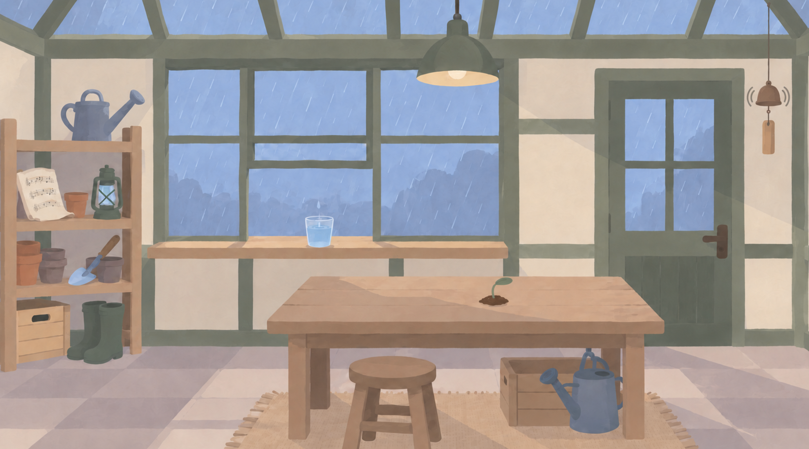

# 基于聚光灯 GameJam 项目的 AI 音频设计探索：Codex 与 ElevenLabs 的协作实践

> 状态（2026-10-16）：选用第二轮雨声 #1，以及第五轮桌面声 #1 经我人工提高响度后的最终版本。种子发芽三轮迭代后仍未找到合适声音，暂不采用。两条选用素材已归档；游戏内验证和音乐实验待开展。

[具体实验计划](experiment-plan.md) · [实验记录表](experiment-records.md)

## 关于这份报告的协作方式

这份报告以我正在制作的聚光灯 GameJam 项目为基础，记录我与 Codex、专业 AI 音频平台 ElevenLabs 一起探索声音设计的过程。项目总体方向、核心工作流、方案采用与素材取舍由我把控。

Codex 在其中承担项目中枢的工作：梳理剧情、玩法和美术资料，结合已有游戏资产提出声音风格建议，把讨论转化为提示词与参数，再协助操作 ElevenLabs、归档生成资产和维护 GitHub。声音由 ElevenLabs 生成；后续是否采用、怎样调整和放回游戏，由我根据实际反馈决定。

报告文字由 Codex 根据本窗口交互和后续实际成果梳理，保留我的表达习惯与判断。试听评价以我的实际反馈或明确注明的测试观察为依据。

## 选用结果与音频试听

[打开带播放器的完整报告](https://Nnnnobel.github.io/shu261-audio-practice-2026/)。GitHub 仓库正文保留试听入口，网页报告内可直接播放。

| 声音 | 当前决定 | 选用版本 | 文件 |
| --- | --- | --- | --- |
| 雨声 | 采用 | 第二轮 #1，20 秒循环素材 | [原始 WAV](../docs/audio/rain-r02-01.wav) |
| 桌面敲击 | 采用 | 第五轮 #1，经我人工提高响度后的最终版本 | [最终 WAV](../docs/audio/wood-tap-final.wav) |
| 种子发芽 | 暂不采用 | 三轮共 12 条候选，仍未找到合适声音 | 不列入选用素材 |

[▶ 试听雨声：第二轮 #1 · elevenlabs.io](https://Nnnnobel.github.io/shu261-audio-practice-2026/#rain)

[▶ 试听桌面敲击：人工调整最终版 · elevenlabs.io](https://Nnnnobel.github.io/shu261-audio-practice-2026/#wood-tap)

两条声音由 ElevenLabs 生成，方案与取舍由我决定，桌面声最终响度由我人工调整。Codex 下载选定雨声、归档文件并整理报告与试听页面。素材用于非商业课程展示，来源标注为 [elevenlabs.io](https://elevenlabs.io)；文件参数、哈希和使用说明见[素材记录](../docs/audio/README.md)。选用表示当前制作决定，尚未完成 Unity 内的适配验证。

## 1. 从正在制作的游戏提出声音需求

<table>
  <tr>
    <td width="48%" valign="top">
      
游戏围绕温室、种子及植物对声音的回应展开。当前画面采用柔和低饱和的手绘色面：室内木桌偏暖，窗外雨景偏冷，水杯、手和种子承担主要互动。音频需要与这些具体物件、动作和空间相配。

    </td>
    <td width="52%" align="center" valign="top">
      
      
参考游戏艺术风格

    </td>
  </tr>
</table>

这次先选择正在用得上的三类声音：温室雨声、桌面敲击和种子发芽。后续音乐讨论以较新的五线按键与植物记忆接奏方案为依据；飞行采集保留为旧原型背景，未确定的第三游戏与完整人物故事继续待定。

核心问题：**在我把控项目与制作方向的前提下，Codex 能怎样结合游戏资料和资产提出建议，再与 ElevenLabs 配合，推进真实的音频设计？**

报告沿着实际制作过程展开：需求如何提出，项目资料怎样影响声音建议，我怎样作出选择，建议如何变成可提交的提示词和参数，以及生成后还需要哪些试听、编辑与游戏验证。

## 2. 人、Codex 与音频平台怎样协作

| 参与方 | 在本次探索中的职责 | 当前依据 |
| --- | --- | --- |
| 我 | 确定研究与制作方向，提供项目要求，决定采用的方案，负责整体把控及后续试听取舍 | 本窗口提出需求、补充边界并授权执行 |
| Codex | 读取和梳理本地剧情、美术及原型资料，结合资产提出声音建议，拟定提示词与参数，操作平台、归档结果并整理报告 | 本窗口建议、Chrome 操作与文件记录 |
| ElevenLabs | 按提交的提示词与参数生成音效候选，提供预览和下载 | 五轮共十个批次、40 条候选；首轮 12 条已下载；第五轮桌面 #1 后由我人工调整响度并下载；选定第二轮雨声 #1 后由 Codex 下载 |

目前 Codex 对游戏资产的整合包括资料梳理、参考图比对，以及首轮生成音频的分类归档。我通过多轮试听提出调整要求，并选定第五轮桌面 #1 进行人工响度调整和下载；桌面声具体增益未记录，Unity 接入尚未核验。项目中枢的作用会通过这些具体工作体现，后续效果仍要结合实际使用判断。

## 3. 从游戏资产到声音建议，再到平台生成

### 3.1 结合本地资料判断声音风格

讨论从通用音效描述推进到项目中的具体场景。Codex 阅读本地剧情、美术规范和较新分镜，查看温室、水杯、敲桌与植物的参考画面，并发现第二游戏已由旧飞行采集转为五线按键与植物记忆接奏。后续声音建议据此调整。

| 项目依据 | Codex 提出的设计建议 | 进入首轮生成的描述 |
| --- | --- | --- |
| 窗外雨景、室内温室和半开窗 | 环境雨声与有节奏的雨杯滴水分开，给提示与音乐留出空间 | 从室内听见的柔和细雨，稍有距离，不含突出的单次滴水 |
| 画面中手指轻敲木桌，玩家需要辨认每次操作 | 保留清楚起音和短木质共鸣，供后续连续触发测试 | 单次轻敲、近距离、短尾音，无背景雨声 |
| 小种子和小幅发芽动作 | 先比较自然的种壳轻裂与嫩芽展开，减少夸张的幻想音效 | 轻裂后接细小摩擦声，不加入魔法钟声或重冲击 |

这些是第一轮结合画面与玩法提出的声音假设，后续通过我的试听反馈继续修改。

### 3.2 我作出选择，Codex 协助执行

我确定调研应服务于正在做的游戏，先选择雨声、桌面敲击和发芽三项，并要求按本地项目进一步细化建议。随后，我授权 Codex 在 Chrome 的 ElevenLabs 页面执行这一轮方案。

Codex 将已讨论的声音描述填入平台，设置时长、循环与提示词影响，分别提交一批生成，再下载并整理全部候选。实际提示词和参数完整保存在[首轮生成记录](generation-log-20261015.md)。

### 3.3 生成后的判断与反馈

第一轮网页试听后，我认为雨声 #1 最接近目标，但要求持续均衡、无雷声，并作为循环素材；木桌敲击候选全部不太合适，希望改成轻轻敲击木板、温暖且不那么结实的质地；发芽声不需要前面清脆的响声，整体应很柔和。

Codex 据此将雨声改为均匀持续的雨底，将敲击改为温暖、圆润的轻敲木板，将发芽改为平滑起音的连续舒展声。时长、循环开关与提示词影响保持不变。我的原话和第二轮中英文提示词见[试听反馈与第二轮调整](iteration-02-20261015.md)。

第二轮后，我指出种子和桌子的素材仍有严重问题：种子只需要极轻微的一声，桌子应沉闷，不能清脆响亮。Codex 继续精简声音描述，去掉叶片窸窣、连续舒展与共鸣要求，将种子时长缩至 0.5 秒，并关闭自动提示词优化。实际设置与中英文对照见[第三轮记录](iteration-03-20261015.md)。没有把第二轮建议写成已成功解决问题。

第三轮桌面声试听后，我以 #1 为参照，要求去掉混响、力度再轻微松软一点。Codex 保留沉闷短声方向，加强干声和软起音的描述，完成桌面声第四轮文本生成，未直接处理 #1 原音频；详情见[第四轮记录](iteration-04-20261015.md)。

第四轮后，我以 #4 为参照，提出 0 秒起音和进一步去混响的要求。Codex 增加无前置静音、无响空间和极短衰减后静音的描述，完成[第五轮生成](iteration-05-20261015.md)。第五轮生成阶段没有裁剪或直接处理旧音频，不能把生成要求视为已核验的起音与混响效果。

后续提示词同时提供英文原文与中文释义，实际提交只使用英文。生成完成后，Codex 先通知我到 ElevenLabs 网页查看候选，不自动下载；待我决定需要编辑或接入游戏时，再安排本地处理。首轮已经下载的事实仍按实际情况记录。

第五轮后，我要求对 #1「单纯提高响度」，随后确认已人工完成并下载。Codex 的网页编辑尝试未完成增益核验，最终处理归于我的人工操作；具体增益未记录，下载文件在选用后由 Codex 核验并归档。我同时明确雨声采用第二轮 #1，桌面声采用刚刚人工完成的最终版本；种子经过多次迭代仍未找到合适声音，暂不采用。

## 4. 实验范围与后续验证

| 类别 | 项目用途 | 所需素材或数据 | 对应实验 |
| --- | --- | --- | --- |
| 环境声 | 温室持续雨声 | 可循环的独立环境声 | E01 |
| 短音效 | 水滴提示、玩家敲桌、种子发芽反馈 | 起音清晰的单次声音及变体 | E02 |
| 音乐 | 五线按键演奏、植物记忆回放与接奏 | 可独立控制的声部、MIDI／谱面及可触发音源 | E03、E04，后续计划 |

本次聚焦 Music 与 SFX，采用离线生成、人工整理和小规模交互验证。Voice、完整配乐制作、实时生成系统和期末 Wwise 工程不列入实验范围。

正式验证时，玩家按键应在实际操作时发声，植物记忆、伴奏与玩家输入应能分别控制。循环接缝、短音效起音与反复触发、发芽动作同步等检查，用来判断生成素材是否适合实际场景。

### 4.1 工具资料与使用状态

本次使用环境（2026-10-15 核对）：

| 平台 | 应用版本 | 使用模型 | 推理强度 | 会员套餐 |
| --- | --- | --- | --- | --- |
| Codex 桌面应用 | 26.1007.71326（构建号 20398） | GPT-6.1 Sol | High | ChatGPT Pro |
| ElevenLabs Sound Effects | 网页版 | — | — | Free（免费套餐） |

Codex 应用版本依据本机安装信息，模型与推理强度由我确认，套餐依据当前登录账户状态；ElevenLabs 免费套餐由我确认。Codex 通过 ChatGPT 订阅使用，相关订阅说明见 [OpenAI 官方文档](https://learn.chatgpt.com/docs/pricing)。

工具资料为实际探索提供依据，具体功能说明与本次验证结果分别记录。

| 候选工具 | 已查阅的官方功能说明 | 拟验证内容 | 实测状态 |
| --- | --- | --- | --- |
| ElevenLabs Sound Effects | 文本生成音效，支持时长与循环控制 | 雨声循环、单次声音及可编辑性 | 雨声第二轮 #1、桌面声人工调整最终版已选用；种子三轮后暂不采用；游戏适配待验证 |
| Suno Studio | 分轨导出、从分轨获取 MIDI、MIDI 文件上传；Studio 属于 Premier 订阅 | 分轨独立性、音符转写及输入 MIDI 后的可控程度 | 未开展 |

功能说明依据文末官方资料，访问日期为 2026-10-15。具体生成参数见各轮实验记录；无法访问的项目保持未开展。

### 4.2 分项计划

步骤、提示词草案、样本数量和评价方法见[实验计划](experiment-plan.md)。

- E01：雨声生成与循环适配。
- E02：水滴、敲桌、发芽单次音效生成与交互适配。
- E03：先生成完整音乐，再拆分整理。
- E04：先确定 MIDI／谱面，再制作声音。

E03、E04 保留为后续音乐制作计划；目前的报告主线围绕已经发生的项目讨论、三类音效生成及后续反馈展开。

## 5. 已取得的素材与试听反馈

### 5.1 E01：雨声生成与循环适配

2026-10-15，通过 Chrome 中的 ElevenLabs Sound Effects 提交一批温室雨声：时长 20 秒、循环开启、提示词影响 30%，返回 4 条候选。已下载 WAV 并检查均为 48 kHz、16 bit、双声道、20 秒；尚未开展循环接缝与叠加试听。实际提示词和参数见[生成记录](generation-log-20261015.md)。

我的首轮试听反馈：#1 最佳，仍需持续均衡、无雷声的循环雨声。未进行系统的循环接缝与叠加测试，最终适配评价留空。

### 5.2 E02：单次音效生成与交互适配

同日首轮生成桌面敲击与种子发芽声各一批、每批 4 条。敲击为 1 秒、非循环、提示词影响 60%；发芽为 2 秒、非循环、提示词影响 50%。8 条 WAV 均为 48 kHz、16 bit、双声道，文件时长与设置一致。未剪辑，水滴单次音效未生成。

我的首轮试听反馈：敲击候选全部不太合适，改为轻敲温暖质地的木板；发芽需要去掉清脆起音，保持整体柔和。连续触发、剪辑与动作同步尚未验证。

### 5.3 E03：完整音乐生成后的整理

<!-- 留空：实验未开展。 -->

### 5.4 E04：以 MIDI／谱面为起点的制作

<!-- 留空：实验未开展。 -->

### 5.5 根据试听反馈进行第二轮生成

Codex 按我的反馈修改英文提示词，提供中文对照，并保持三组其他参数不变，在 Chrome 的 ElevenLabs 页面各生成 4 条新候选，共 12 条。本轮没有下载或编辑，我将先在网页试听。完整修改原因、实际提示词与页面显示结果见[第二轮记录](iteration-02-20261015.md)。

2026-10-16，我确认第二轮雨声 #1 可以取用。选定后由 Codex 下载 WAV 并原样归档，未做额外响度或剪辑处理。循环接缝与游戏内叠加仍未系统验证。

### 5.6 精简描述后进行第三轮生成

第二轮反馈表明，种子仍有不需要的附加声音，桌子仍过于清脆响亮。Codex 根据我的要求精简提示词，将种子改为 0.5 秒的轻微单次短声、桌子改为 1 秒的沉闷轻敲，两组均关闭自动提示词优化。各生成 4 条，共 8 条，留在网页供我试听，没有下载。后来我确认种子经过多次迭代仍未找到合适声音，暂不采用；桌面声继续迭代。完整过程见[第三轮记录](iteration-03-20261015.md)。

种子发芽累计三轮、12 条候选，当前仍没有我认可的版本；这一结果保留为未达到项目要求的尝试。

### 5.7 以桌面声 #1 为参照继续微调

根据我的第三轮桌面声反馈，Codex 保持 1 秒、非循环、提示词影响 60% 和自动优化关闭，只修改描述，生成 4 条更轻、更松软且要求无混响的新候选。没有下载或对旧音频做去混响处理，第四轮效果仍待试听。

我的第四轮反馈：以 #4 为参照，要求 0 秒立即起音，混响仍太大。

### 5.8 增加明确起音时刻与无响空间描述

Codex 保持桌面声参数不变，按我的反馈进行第五轮文本生成，返回 4 条候选，未下载。实际英文和中文释义见[第五轮记录](iteration-05-20261015.md)。是否从 0 秒起音、混响是否减少，仍待验证。

### 5.9 选定 #1 后由我人工调整响度

2026-10-16，我要求只提高第五轮桌面声 #1 的响度。Codex 尝试在 ElevenLabs 网页工作室调整片段音量，但在我接手前未完成增益调整与核验。随后我确认已人工完成并下载，详细经过见[第五轮记录](iteration-05-20261015.md)。这次不增加生成次数；实际增益未记录。选用文件已核验为 1 秒、44.1 kHz、16 bit、双声道 WAV；原文件名为 `ElevenLabs_Untitled_project.wav`，归档为 `docs/audio/wood-tap-final.wav`。未再处理音频，游戏适配仍待验证。

## 6. 这套协作方式能帮上什么，哪些工作仍由人判断

这次三类声音的结果有明显差别。雨声这种常见声音，在本次尝试中比较容易生成：两轮后，我已经能选出可用版本。桌面敲击虽然也很常见，但我对它的要求更具体——温暖、沉闷、轻微、无明显混响，还要立即起音。它经历五轮生成，最后再由我人工调整响度，才成为当前选用版本。

种子发芽则没有得到合适结果。我需要的只是极轻微、整体柔和的一声，前几轮却出现清脆起音或其他不需要的附加声音。即使后来缩短时长、精简描述、关闭自动提示词优化，三轮之后我仍没有找到合适版本，所以暂不采用。报告保留这一结果，不把每次生成完成都写成设计目标已经实现。

我的直观推测是，雨声这类常见声音可能有更丰富的训练素材，因此更容易生成。但本次没有取得平台训练数据，无法确认其实际数量，也没有进行足以验证因果关系的对照实验。这里能直接确认的是：**在本项目的这组需求里，雨声较容易选出可用结果，种子发芽仍未满足我的要求。**

Codex 的帮助主要在于把游戏画面、物件与交互需求整合为建议，把我的试听反馈持续转化为英文提示词，并整理资产和过程。判断声音是否合适、决定何时继续生成或转为人工处理，以及最终采用什么，始终由我控制。这次桌面声转入人工响度调整，也是工作流中的实际选择。

## 7. 当前阶段的结论

本次探索已经取得两条我决定取用的素材：第二轮雨声 #1 和人工调整后的桌面敲击最终版；种子发芽暂不采用。AI 音频生成可以推进真实项目中的部分声音制作，但能否满足要求取决于具体声音和用途，生成完成仍需要人的试听判断与取舍。

这是一项阶段结果。循环接缝、连续敲击、动作同步与 Unity 内混音尚未验证，音乐实验也未开展，不能据此认定整套游戏音频制作已经完成。

## 8. 参考资料与素材来源

以下为工具能力说明的来源，不作为实验结果，访问日期均为 2026-10-15：

1. ElevenLabs. [Sound effects](https://elevenlabs.io/docs/overview/capabilities/sound-effects).
2. Suno. [Exporting from Studio](https://help.suno.com/en/articles/13925249).
3. Suno. [Introducing Suno Studio 2.0](https://help.suno.com/en/articles/13670529).

4. ElevenLabs. [Can I publish the content I generate on the platform?](https://help.elevenlabs.io/hc/en-us/articles/13313564601361-Can-I-publish-the-content-I-generate-on-the-platform)，2026-10-16 核对：免费套餐生成内容用于非商业分享并注明 `elevenlabs.io`。本仓库的音频不声明为 CC0 或另行授予商业使用权。

实际采用的声音生成于 2026-10-15，选定并归档于 2026-10-16，文件来源与校验信息见[素材记录](../docs/audio/README.md)。
